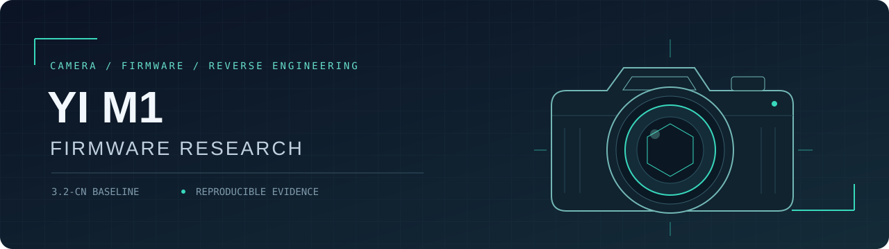

<div align="center">



**小蚁 M1 固件逆向研究 · 让每一个结论都能回到证据**


[研究进展](#研究进展) · [快速开始](#快速开始) · [代码地图](#阅读导航) · [参与研究](#参与研究)

</div>

---

这是一份面向逆向研究者的 **YI / XIAOYI M1 微单相机研究资料库**。以官方 **3.2-cn** 为主要输入、**3.1-cn** 为对照，整理固件容器、启动与升级路径、取景曝光链、远程协议、函数地址和可复现实验。

研究目标是为随机挂死、响应迟缓、对焦慢和 M 档曝光预览问题积累可核查的证据。**目前没有经过真机验证的修复固件，也不提供刷机包。**

> **For reverse engineers:** an evidence-driven research archive for the YI M1, covering firmware containers, boot/update paths, ARM code maps, live-view exposure and offline experiments. Most notes are in Chinese. Static addresses refer to candidate decoded images; no hardware-validated fix is available.

## 研究进展

公开整理：**2026-10-28**。主要研究记录：2026-10-26 至 2026-10-27。

| 方向 | 已有结果 | 仍待解决 |
| :--- | :--- | :--- |
| 固件容器与解码 | 段表、`SUM=` 字节累加、独立解码器对照与 token 往返检查 | 主程序由 SoC 硬件解压；尚无硬件原生对照 |
| 启动、升级与恢复 | IPL、主程序升级器及 FIRM / BOOT 路径 | 未证实可依赖的外部救砖入口；解码失败不能假定自动回退 |
| 代码地图 | 本地导出 **27,107 个函数 / 107,849 条字符串**；提供重建脚本与已知地址种子表 | 全量导出不代表全量审阅；需核对原始指令 |
| 远程命令边界 | **106 个 Unicorn 隔离用例**与补丁清单 | 未证明是日常挂死根因；未做真机补丁验证 |
| M 档曝光预览 | 真机对照、AE / 快门 / 增益线索与实验补丁 | 完整功能尚未经真机验证 |
| 稳定性与对焦 | 症状、消息/队列与等待路径线索 | 随机挂死、卡顿和对焦慢的根因仍未定位 |

**证据等级：** 真机观察、原始指令核对、模拟器隔离验证、统计/结构证据和推断应分别理解。模拟器通过不能证明整机稳定，候选解码地址不能直接作为安全补丁地址。较早报告中的结论可能已被后续报告纠正，见 [当前状态](docs/project-status.md)。

## 阅读导航

| 研究方向 | 建议入口 |
| :--- | :--- |
| 函数、全局地址和证据来源 | [已知函数与地址种子表](reports/code-map/known-functions.md) |
| 函数目录、调用关系、代码分片 | [代码地图流水线](docs/code-map-pipeline.md) |
| 解码歧义、重打包与校验 | [编解码调查](reports/codec-investigation.md) · [打包链复核](reports/repack-pipeline-2026-10-27.md) |
| IPL、升级器与恢复 | [升级和恢复路径](reports/update-recovery-path-2026-10-27.md) |
| AE 与曝光施加 | [取景 AE 定位](reports/monitor-ae-locate-2026-10-27.md) · [曝光施加路径](reports/exposure-apply-path-2026-10-27.md) |
| 曝光预览实验补丁 | [候选补丁与限制](reports/exposure-preview-patch-2026-10-27.md) |
| 远程命令表搜索边界 | [命令越界调查](reports/command-bounds-investigation.md) |
| HTTP / UDP 取景采集 | [直接取景采集](docs/direct-liveview-capture.md) · [曝光实验](docs/exposure-preview-probe.md) |
| 上游成果与工具来源 | [研究来源](docs/research.md) · [复现指南与第三方工具](docs/getting-started.md) |

## 快速开始

克隆后可以先读报告、运行合成数据测试，无需连接相机或准备固件。

```powershell
git clone https://github.com/zeroa234/XIAOYI_M1.git
cd XIAOYI_M1

# Python 3.11+；这两项不需要安装第三方依赖。
python -B tests/test-liveview-metadata.py
python -B tests/test-repack.py TokenTests
```

重建固件分析输入时，自行取得官方文件并放到下面的路径。脚本会核对哈希，版本或哈希不匹配时应停止分析。

| 输入 | 项目内路径 | SHA-256（firmware.bin） |
| :--- | :--- | :--- |
| 官方 3.2-cn | `data/input/body-3-2-cn/firmware.bin` | `92b3f1fda39e37351432d19d0167879f477eb71713a8fbc94b3ba2141ca404e4` |
| 官方 3.1-cn | `data/input/body-3-1-cn/firmware.bin` | `97dfa394efc91f8643c3b1a0673be2dd96590754b29080ce60d3498ebe3d15be` |

完整步骤见 **[复现指南](docs/getting-started.md)**。官方固件、第三方工具、Ghidra 工程和全量反编译输出需要在本地准备，不随仓库分发。

## 项目结构

```text
config/       分析地址、依赖版本与实验补丁清单
docs/         复现指南、研究方法与代码地图说明
reports/      调查报告、脱敏实验数据与已知函数种子表
scripts/      拆包适配、独立校验、Ghidra 导出与离线实验
src/          取景元数据解析与实验汇编
tests/        合成数据与本地协议测试
assets/       项目展示资源
```

运行时的 `data/input/`、`vendor/`、`output/`、`logs/`、`temp/` 已排除提交。公开版使用独立历史，详见 [公开范围与脱敏说明](docs/publication.md)。

## 参与研究

欢迎通过 [Issues](https://github.com/zeroa234/XIAOYI_M1/issues) 或 Pull Request 提交分析和修正。请附上：

- **输入身份：** 固件区域、版本及 SHA-256。
- **定位依据：** 映像、地址类型、原始字节/指令和调用关系。
- **验证方式：** 复现命令、预期与实际结果、证据等级及未覆盖条件。
- **设备实验：** 匿名化的环境和步骤，去掉序列号、Wi-Fi 信息和私人画面。

优先需要协助：故障时的运行期证据、硬件解码对照、M 档 AE 到传感器/ISP 的完整数据流，以及恢复路径的独立确认。实验候选尚无证据支持直接用于日常刷机。

## 致谢与使用范围

研究复用了 [protyposis 的固件工具](https://github.com/protyposis/yi-mirrorless-firmware-tools)、[cebix 的 LZSS 实现](https://github.com/cebix/ff7tools)、[bullbin 的取景研究](https://github.com/bullbin/xiaoyi_m1_re_liveview)，以及 Ghidra、Capstone、Unicorn 等现成工具。锁定版本见 [复现指南](docs/getting-started.md)，自写适配和实验代码的范围在源码与报告中说明。

非官方研究项目，与相机厂商无隶属关系。固件和第三方代码的权利归原权利人；本仓库尚未指定统一开源许可证。
